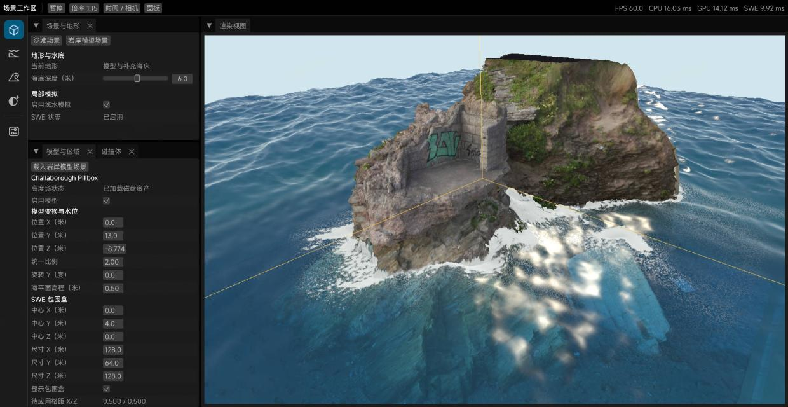

<div align="center">

# Wgpu Water Simulation

</div>

<div align="center">

English | [简体中文](readme/zh-CN.md) | [日本語](readme/ja-JP.md) | [Français](readme/fr-FR.md)

</div>

A Rust water simulation project combining a wgpu ocean renderer, FFT waves, and local shallow-water simulation, with separate CPU terminal demos.

<p align="center">
  
</p>

## Quick Start

### Install

Run from source with a current stable [Rust toolchain](https://rustup.rs/) and a GPU supporting compute shaders and vertex-stage storage buffers.

```sh
git clone https://github.com/gloridifice/wgpu-water-simulation.git
cd wgpu-water-simulation
cargo run --release
```

This launches GPU Ocean. Assets are included in the repository; the first build downloads dependencies. For command-line options:

```sh
cargo run --release -- --help
```

Run without scene presets to restore saved settings: `--beach` and `--model` override parts of the saved scene. See the [Ocean guide](doco/guides/ocean.md) for controls and configuration.

### Update

Save or commit local changes, including any modified files under `configs/`, before updating. From the repository root:

```sh
git pull --ff-only
cargo run --release
```

## Features

- GPU spectrum evolution and inverse FFT for offshore waves.
- Local 2D shallow-water simulation with first- and second-order solvers, driven by FFT waves.
- Separate offshore foam, shoreline foam transport, beach wetness, and optional GPU spray particles.
- Water, seabed, and sky rendering with scanned coastal terrain support.
- Dockable egui parameter panels, saved sessions, and named configurations.
- CPU 2D PIC and 1D shallow-water terminal demos in `crates/tui-2d-prototype`, with no GPU dependencies.
- A separate [3D liquid simulation library](crates/tall-cell-fluid/README.md) with its own demo; not integrated into Ocean.

## Build from Source

The project uses Rust 2024. From the cloned repository:

```sh
cargo build --release --bin ocean
```

To run the CPU PIC demo without compiling GPU dependencies:

```sh
cargo run --release -p tui-2d-prototype
```

See the [PIC guide](doco/guides/pic.md) and [1D shallow-water guide](doco/guides/shallow.md) for terminal controls and other modes.

## License

No project-level license is currently provided. Bundled assets have separate terms; see the [model notices](assets/models/NOTICE.md), [foam sources](assets/foam/SOURCES.md), [spray sources](assets/spray/README.md), and [UI theme license](assets/egui_themes/LICENSE-wgpu_pbr.txt).

## Development

Detailed guides are primarily in Chinese.

- [Ocean usage and GPU verification](doco/guides/ocean.md)
- [CPU PIC simulation](doco/guides/pic.md)
- [1D shallow-water simulation](doco/guides/shallow.md)
- [Foam diagnostics and benchmarks](doco/guides/foam-lab.md)
- [Saved settings and experiments](configs/README.md)
- [Current architecture](doco/architecture.md)
- [Repository development guidelines](AGENTS.md)
