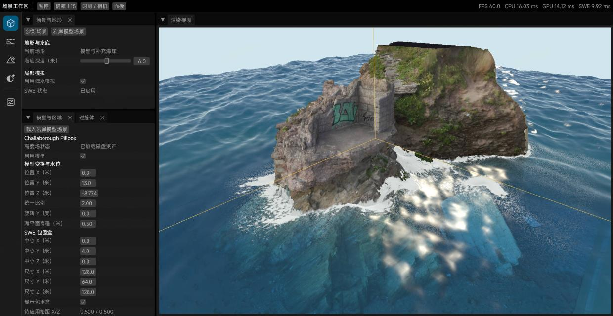

<div align="center">

# Wgpu Water Simulation

</div>

<div align="center">

[English](../README.md) | [简体中文](zh-CN.md) | [日本語](ja-JP.md) | Français

</div>

Un projet Rust de simulation de l’eau associant un rendu océanique avec wgpu, des vagues FFT et une simulation locale en eau peu profonde, avec des démonstrations CPU indépendantes dans le terminal.

<p align="center">
  
</p>

## Démarrage rapide

### Installation

L’exécution se fait depuis les sources. Prévoyez une [chaîne d’outils Rust](https://rustup.rs/) stable et récente, ainsi qu’un GPU prenant en charge les compute shaders et les tampons de stockage dans l’étage de traitement des sommets.

```sh
git clone https://github.com/gloridifice/wgpu-water-simulation.git
cd wgpu-water-simulation
cargo run --release
```

Cette commande lance GPU Ocean. Les ressources sont incluses dans le dépôt ; la première compilation télécharge les dépendances. Pour les options en ligne de commande :

```sh
cargo run --release -- --help
```

Pour restaurer les réglages enregistrés, ne précisez pas de préréglage de scène : `--beach` et `--model` remplacent une partie de ces réglages. Consultez le [guide Ocean](../doco/guides/ocean.md) pour les commandes et la configuration.

### Mise à jour

Sauvegardez ou commitez vos modifications locales, y compris celles des fichiers sous `configs/`, avant la mise à jour. Depuis la racine du dépôt :

```sh
git pull --ff-only
cargo run --release
```

## Fonctionnalités

- Évolution du spectre et FFT inverse sur GPU pour les vagues au large.
- Simulation locale 2D en eau peu profonde, alimentée par les vagues FFT, avec solveurs du premier et du second ordre.
- Gestion distincte de l’écume au large, du transport de l’écume côtière, de l’humidité du sable et des particules d’embruns GPU optionnelles.
- Rendu de l’eau, du fond marin et du ciel, avec prise en charge de terrains côtiers numérisés.
- Panneaux de paramètres egui ancrables, sessions enregistrées et configurations nommées.
- Démonstrations CPU dans le terminal : PIC 2D et eau peu profonde 1D, dans `crates/tui-2d-prototype`, sans dépendances GPU.
- Une [bibliothèque de simulation de liquide 3D](../crates/tall-cell-fluid/README.md) distincte, avec sa propre démonstration ; non intégrée à Ocean.

## Compilation depuis les sources

Le projet utilise Rust 2024. Depuis le dépôt cloné :

```sh
cargo build --release --bin ocean
```

Pour lancer la démonstration CPU PIC sans compiler les dépendances GPU :

```sh
cargo run --release -p tui-2d-prototype
```

Consultez le [guide PIC](../doco/guides/pic.md) et le [guide de simulation en eau peu profonde 1D](../doco/guides/shallow.md) pour les commandes du terminal et les autres modes.

## Licence

Aucune licence générale du projet n’est actuellement fournie. Les ressources incluses ont leurs propres conditions ; consultez les [mentions des modèles](../assets/models/NOTICE.md), les [sources de l’écume](../assets/foam/SOURCES.md), les [sources des embruns](../assets/spray/README.md) et la [licence du thème d’interface](../assets/egui_themes/LICENSE-wgpu_pbr.txt).

## Développement

Les guides détaillés sont principalement en chinois.

- [Utilisation d’Ocean et vérification GPU](../doco/guides/ocean.md)
- [Simulation CPU PIC](../doco/guides/pic.md)
- [Simulation en eau peu profonde 1D](../doco/guides/shallow.md)
- [Diagnostics et benchmarks de l’écume](../doco/guides/foam-lab.md)
- [Réglages enregistrés et expériences](../configs/README.md)
- [Architecture actuelle](../doco/architecture.md)
- [Consignes de développement du dépôt](../AGENTS.md)
