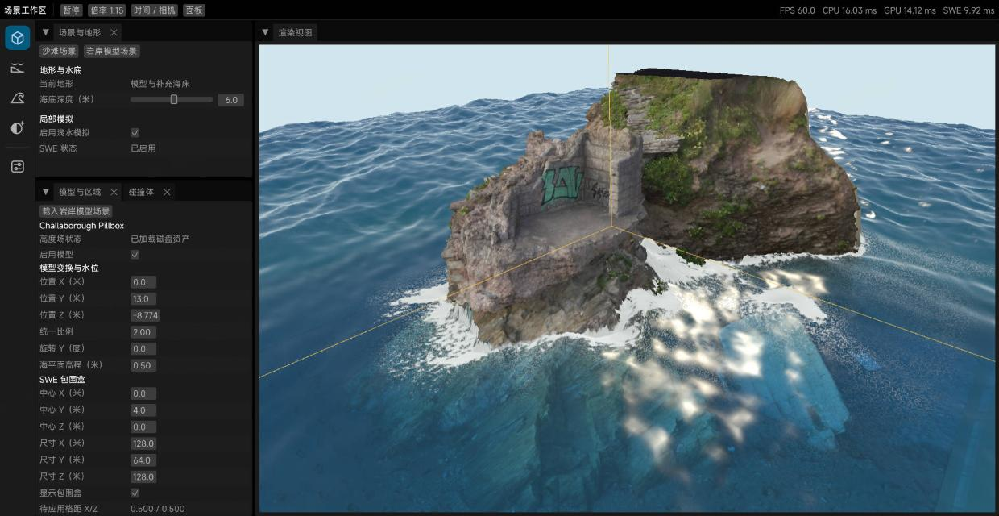

<div align="center">

# Wgpu Water Simulation

</div>

<div align="center">

[English](../README.md) | [简体中文](zh-CN.md) | 日本語 | [Français](fr-FR.md)

</div>

wgpu による海洋描画、FFT 波浪、局所的な浅水シミュレーションを組み合わせた Rust プロジェクトです。独立した CPU ターミナルデモも含みます。

<p align="center">
  
</p>

## クイックスタート

### インストール

ソースから実行します。最新の安定版 [Rust ツールチェーン](https://rustup.rs/) と、コンピュートシェーダーおよび頂点ステージのストレージバッファに対応した GPU が必要です。

```sh
git clone https://github.com/gloridifice/water-simulation.git
cd water-simulation
cargo run --release
```

GPU Ocean が起動します。アセットはリポジトリに含まれ、初回ビルド時に依存関係がダウンロードされます。コマンドラインオプションはヘルプで確認できます。

```sh
cargo run --release -- --help
```

保存した設定を復元するときは、シーンプリセットを指定しないでください。`--beach` と `--model` は保存済みのシーン設定を一部上書きします。操作と設定は [Ocean ガイド](../doco/guides/ocean.md)を参照してください。

### 更新

`configs/` 内の変更を含め、ローカルの変更を保存またはコミットしてから、リポジトリのルートで実行します。

```sh
git pull --ff-only
cargo run --release
```

## 機能

- GPU 上での波スペクトルの時間発展と逆 FFT による沖合の波浪。
- FFT 波浪を入力とする局所的な二次元浅水シミュレーション。一次・二次精度のソルバーに対応。
- 個別に扱う沖合の泡、沿岸の泡の輸送、砂浜の湿潤状態と、任意で有効化できる GPU 飛沫粒子。
- 水、海底、空の描画と、スキャンした海岸地形への対応。
- ドッキング可能な egui パラメータパネル、セッション保存、名前付き設定。
- GPU に依存しない CPU 二次元 PIC・一次元浅水ターミナルデモ。`crates/tui-2d-prototype` に分離。
- 独自のデモを備えた別個の[三次元液体シミュレーションライブラリ](../crates/tall-cell-fluid/README.md)。Ocean には未統合。

## ソースからビルド

Rust 2024 を使用しています。クローンしたリポジトリで実行します。

```sh
cargo build --release --bin ocean
```

GPU 関連の依存関係をコンパイルせずに CPU PIC デモを実行するには：

```sh
cargo run --release -p tui-2d-prototype
```

ターミナル操作やその他のモードについては、[PIC ガイド](../doco/guides/pic.md)と[一次元浅水ガイド](../doco/guides/shallow.md)を参照してください。

## ライセンス

プロジェクト全体のライセンスは現在提供されていません。同梱アセットには個別の条件があります。[モデルの表記](../assets/models/NOTICE.md)、[泡の出典](../assets/foam/SOURCES.md)、[飛沫の出典](../assets/spray/README.md)、[UI テーマのライセンス](../assets/egui_themes/LICENSE-wgpu_pbr.txt)を参照してください。

## 開発

詳細ドキュメントは主に中国語です。

- [Ocean の使い方と GPU 検証](../doco/guides/ocean.md)
- [CPU PIC シミュレーション](../doco/guides/pic.md)
- [一次元浅水シミュレーション](../doco/guides/shallow.md)
- [泡の診断とベンチマーク](../doco/guides/foam-lab.md)
- [保存設定と実験用設定](../configs/README.md)
- [現在のアーキテクチャ](../doco/architecture.md)
- [リポジトリの開発指針](../AGENTS.md)
