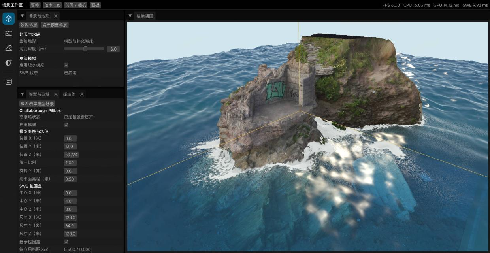

<div align="center">

# Wgpu Water Simulation

</div>

<div align="center">

[English](../README.md) | 简体中文 | [日本語](ja-JP.md) | [Français](fr-FR.md)

</div>

Rust 水体模拟项目，结合 wgpu 海洋渲染、FFT 波浪与局部浅水模拟，并保留独立的 CPU 终端演示。

<p align="center">
  
</p>

## 快速开始

### 安装

从源码运行，需要当前稳定版 [Rust 工具链](https://rustup.rs/)，以及支持计算着色器和顶点阶段存储缓冲区的 GPU。

```sh
git clone https://github.com/gloridifice/water-simulation.git
cd water-simulation
cargo run --release
```

默认启动 GPU Ocean。素材随仓库提供；首次构建会下载依赖。命令行选项见内置帮助：

```sh
cargo run --release -- --help
```

恢复已保存设置时不要指定场景预设：`--beach` 和 `--model` 会覆盖部分场景设置。操作与配置详见 [Ocean 使用说明](../docs/ocean.md)。

### 更新

更新前保存或提交本地改动，包括 `configs/` 下被修改的文件。在仓库根目录运行：

```sh
git pull --ff-only
cargo run --release
```

## 功能

- 在 GPU 上演化波谱、执行逆 FFT，生成远海波浪。
- FFT 驱动局部二维浅水模拟，支持一阶和二阶求解器。
- 独立的远海泡沫、近岸泡沫输送、沙滩湿润状态及可选 GPU 浪花粒子。
- 水体、海底与天空渲染，支持扫描海岸地形。
- 可停靠的 egui 参数面板、会话保存与命名配置。
- CPU 二维 PIC 和一维浅水终端演示，无需启用 `ocean` feature。
- 独立的[三维液体模拟库](../crates/tall-cell-fluid/README.md)，附带自己的演示程序，尚未接入 Ocean。

## 从源码构建

项目使用 Rust 2024。在克隆后的仓库中运行：

```sh
cargo build --release --bin ocean
```

运行 CPU PIC 演示，不编译 GPU 依赖：

```sh
cargo run --release --no-default-features --bin water-simulation
```

终端操作与其他模式见 [PIC 说明](../docs/pic.md)和[一维浅水说明](../docs/shallow.md)。

## 许可证

仓库目前未提供项目级许可证。随附资源有各自的许可条款，见[模型声明](../assets/models/NOTICE.md)、[泡沫来源](../assets/foam/SOURCES.md)、[浪花来源](../assets/spray/README.md)及 [UI 主题许可证](../assets/egui_themes/LICENSE-wgpu_pbr.txt)。

## 开发

详细文档主要使用中文。

- [Ocean 使用与 GPU 验证](../docs/ocean.md)
- [CPU PIC 模拟](../docs/pic.md)
- [一维浅水模拟](../docs/shallow.md)
- [泡沫诊断与基准测试](../docs/foam-lab.md)
- [保存设置与实验配置](../configs/README.md)
- [当前架构](../doco/architecture.md)
- [仓库开发约定](../AGENTS.md)
